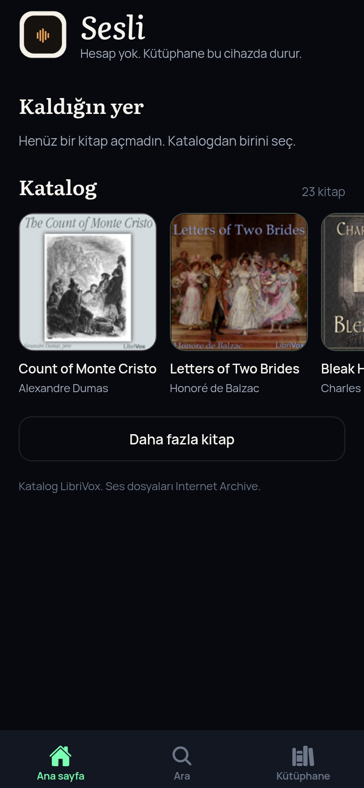
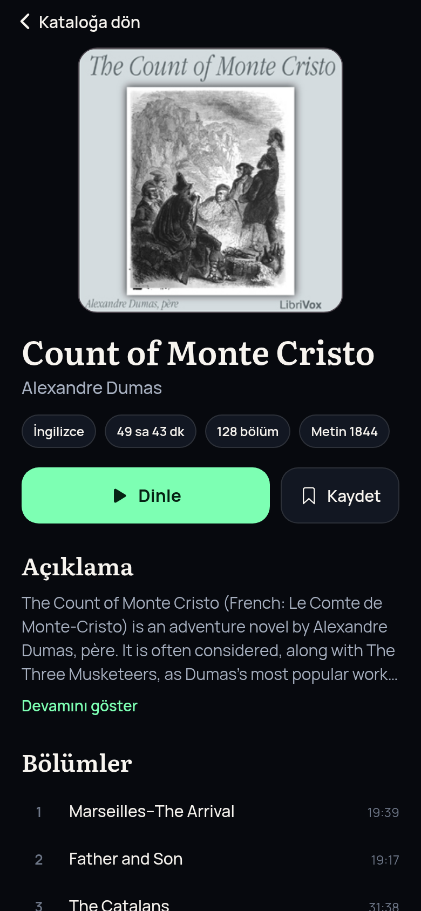
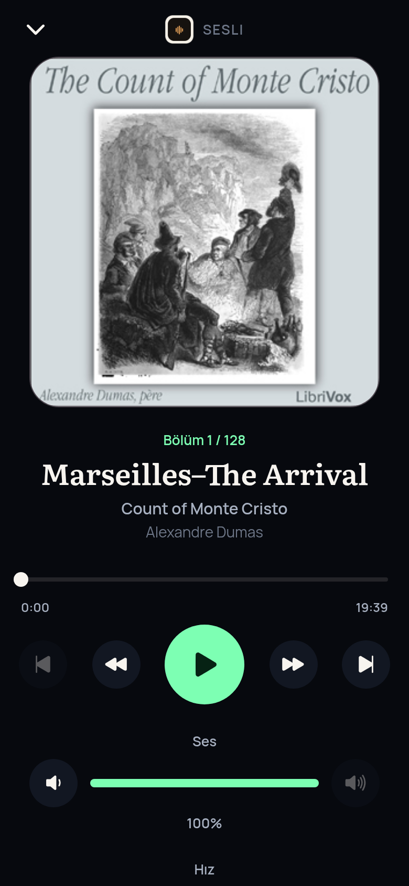

# Sesli

Kişisel sesli kitap uygulaması. Hesap yok, kendi sunucumuz yok. Katalog [LibriVox](https://librivox.org/api/info) açık API’sinden gelir. Ses dosyaları Internet Archive adreslerindedir.

## Ekranlar

Ana sayfa. Logo, kaldığın yer ve kapak rafı.



Kitap. Kapak, yazar, açıklama ve bölümler.



Oynatıcı. Sarma, bölüm atlama, ses ve hız.



## Kurulum

```bash
npm install
npx expo start
```

Telefonda güncel Expo Go aç. Telefon ve bilgisayar aynı Wi-Fi’da olsun. QR kodu iPhone Kamerası veya Android’de Expo Go ile okut. Ağ tutmazsa `npx expo start --tunnel`.

Web önizleme: `npx expo start --web`

`npx expo run:android` masaüstündeki uzun klasör yolunda Windows yüzünden düşebilir. Expo Go yeter. Yerel derleme için projeyi `C:\sesli` gibi kısa bir yola taşı.

Hazır Android paketi arm64’tür ve ayrı dağıtılır. Bu depoda APK yoktur.

## Katalog

- Liste: `https://librivox.org/api/feed/audiobooks?format=json&coverart=1`
- Bölümler: `https://librivox.org/api/feed/audiotracks?project_id=<id>&format=json`
- Çalınabilir sayılması için dosyanın `archive.org` üzerinde bir ses dosyası olması gerekir.
- Web önizlemede istek, tarayıcı CORS’u nedeniyle geliştirme sunucusundaki `/librivox-proxy` üzerinden aynı herkese açık uca gider. Telefonda doğrudan LibriVox çağrılır.

Kütüphane ve kaldığın yer yalnız cihazda, AsyncStorage ile durur.

## Test

```bash
npm test
```

Ağ gerekir. Canlı testler LibriVox’a gider.

## iPhone paketi

Bu depo Linux’ta hazırlandı. Apple, kurulabilir bir iOS paketi için Mac ve ücretli geliştirici hesabı ister. Expo Go yoksa, kendi bilgisayarında:

```bash
npx eas-cli login
npx eas-cli build --platform ios --profile preview
```

Mağazaya gönderilmez.
